# Knee MRI Assistant – integration prototype (internal R&D)

Private research prototype for an AI assistant that reads **complete knee MRI studies** (all DICOM
series) and returns experimental scores for ACL, MCL, medial meniscus and lateral meniscus injury.

> **Research demonstration only.** Outputs are experimental model scores, not diagnoses and not calibrated
> clinical probabilities. Not a medical device. Not clinically validated.

## Status (v0.1)

| Item | Status |
|---|---|
| End-to-end pipeline (DICOM → series selection → model → report) | Implemented, passes synthetic smoke test |
| Pseudonymisation + identifier check | Implemented, profile v0.2: recursive, value-type based (names, dates, free text, private tags, UID remapping at every nesting level); visual burned-in text review still required |
| Automated tests | 11 tests (regressions + end-to-end smoke) run on every push via GitHub Actions, synthetic data only |
| Third-party model: download, hash, safe load | Passed (`weights_only=True`, strict key match, 12,656,716 params) |
| Test on clinical partner studies | See `outputs/TECHNICAL_DEMONSTRATION_REPORT_<date>.md` |
| Diagnostic performance | **Not established.** The third-party checkpoint records `epoch=1/25, best_metric=0.5` (minimal training). Training on partner data is project work. |

## Architecture

```mermaid
flowchart LR
    A[PACS export<br/>full DICOM study] --> B[deid.py<br/>pseudonymise at partner site<br/>key stays with partner]
    B --> C[dicom_index.py<br/>group by series, split mixed stacks<br/>plane / fluid / fat-sat / localizer]
    C --> D[series_select.py<br/>explicit slot rule, max 6 series<br/>every image decoded]
    D --> E[third-party preprocessing<br/>slice ordering, 16 slices/series<br/>224x224, percentile norm]
    E --> F[engine.py<br/>SHA-256 pinned checkpoint<br/>weights_only load, blank-slice guard]
    F --> G[ResNet-18 slice encoder<br/>+ series metadata<br/>+ mean-max pooling → 12 logits]
    G --> H[cli.py run<br/>scores, thresholds, labels vs reference]
    H --> I[results.csv · montage.png · result.json]
    I --> J[report.py<br/>dated technical report]
```



| Module | Role | Origin |
|---|---|---|
| `kneeai/deid.py` | Pseudonymisation profile v0.2 applied at every nesting depth: person names, dates/times, free text, identifying attributes and private tags removed; all non-standard UIDs remapped with a secret salt (references stay consistent); recursive identifier scanner | Team |
| `kneeai/dicom_index.py` | Reads any export layout, groups by SeriesInstanceUID and splits mixed stacks (orientation / image type / echo), classifies plane, fluid sensitivity, fat suppression, localizers, multi-frame; decodes every image | Team |
| `kneeai/series_select.py` | Explicit, logged selection of up to 6 series (replaces "first 6 folders" behaviour); staging by hard links in a temporary folder that is always removed | Team |
| `kneeai/engine.py` | Pinned hash, safe loading, strict keys, deterministic settings, blank-slice guard, finite-output check | Team |
| `kneeai/cli.py`, `report.py`, `visualize.py`, `envinfo.py` | Run recording, reference comparison, reproducibility, montage, environment record, report | Team |
| `third_party/rsna_knee_kaggle_model/` | Network architecture, preprocessing, config, thresholds (MIT) – commit `a254152c1e7c` | Third party |

## Quick start (Windows)

```powershell
# 1. one-time setup: creates .venv, installs packages, downloads + verifies the weights
powershell -ExecutionPolicy Bypass -File scripts\setup_windows.ps1

# 2. checks without patient data
.\.venv\Scripts\python -m kneeai env
.\.venv\Scripts\python -m kneeai verify-model
.\.venv\Scripts\python -m kneeai smoke-test

# 3. partner studies – see docs/TEST_PROTOCOL.md
.\.venv\Scripts\python -m kneeai deid    --input D:\export\study1 --output C:\KneeDemo\pseudo --case ELDA-K001 --key-file D:\ELDA_KEY\key.csv
#   (asks for the secret salt without showing it, so it never lands in the command history)
.\.venv\Scripts\python -m kneeai inspect --study C:\KneeDemo\pseudo\ELDA-K001
.\.venv\Scripts\python -m kneeai run     --study C:\KneeDemo\pseudo\ELDA-K001 --case ELDA-K001 --run-label run1
.\.venv\Scripts\python -m kneeai run     --study C:\KneeDemo\pseudo\ELDA-K001 --case ELDA-K001 --run-label run2
.\.venv\Scripts\python -m kneeai report
```

## Data rules

- No DICOM files, reports, re-identification keys, credentials or images are committed (`.gitignore`).
- Only pseudonymised studies are processed; `run` refuses a study whose headers still contain identifiers.
- Partner data is never uploaded to Colab, Kaggle or any public service.
- Montage images are kept out of Git; share them only after visual privacy review.

## Documents

- `docs/TEST_PROTOCOL.md` – step-by-step procedure for the partner-data demonstration
- `docs/MODEL_RIGHTS.md` – licence and provenance record of the third-party model
- `data/reference_labels_template.csv` – radiologist reference label sheet
